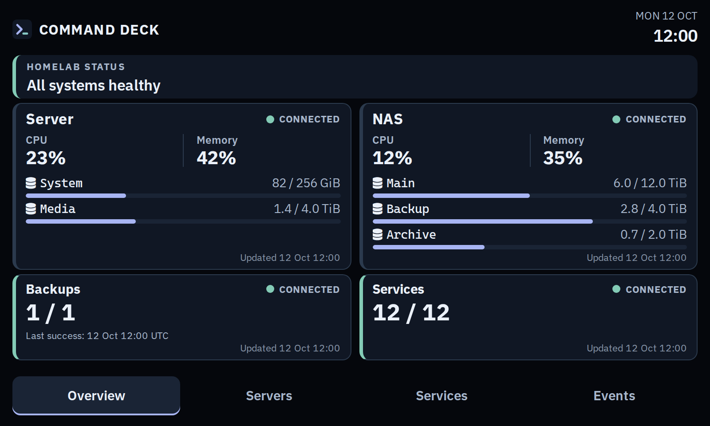

#  Command Deck

A small homelab dashboard for server capacity, backups, and service health. It reads Prometheus, Healthchecks, Uptime Kuma, and optional TrueNAS data without access to the Docker socket or monitored files.



*Screenshot uses illustrative data.* [More screenshots](docs/screenshots/) · [Configuration and operations](docs/guide.md)

## Run with Docker Compose

The included [`compose.yaml`](compose.yaml) pulls the published image and maps host port 8000 to the container:

```yaml
services:
  command-deck:
    image: ghcr.io/mravalanche/command-deck:latest
    restart: unless-stopped
    env_file: .env
    volumes:
      - ./config.yml:/app/config.yaml:ro
    ports:
      - "8000:8000"
    logging:
      driver: json-file
      options:
        max-size: 10m
        max-file: "3"
```

To run it:

```sh
cp config.yaml config.yml
cp .env.example .env
# Edit config.yml and .env with your source addresses and API keys.
docker compose config --quiet
docker compose up -d
```

Open <http://127.0.0.1:8000>. The sample addresses below are placeholders; data remains unknown until the sources are reachable. Keep API keys in the ignored `.env` file, using [`.env.example`](.env.example) as a guide.

Run `docker compose logs -f command-deck` to see startup connection results and later source changes.

## Example configuration

This is also available as [`config.yaml`](config.yaml). Copy it to the ignored `config.yml` before editing. `# optional` marks settings you can omit; the example includes them to show what can be customized.

```yaml
prometheus:
  url: http://prometheus.example.invalid:9090
  timeout_seconds: 3 # optional
  cache_seconds: 20 # optional
  max_sample_age_seconds: 90 # optional

capacity: # optional
  warning_available_percent: 15 # optional
  critical_available_percent: 5 # optional

healthchecks: # optional
  url: http://healthchecks.example.invalid:8000 # optional
  backup_tag: backup # optional
  timeout_seconds: 3 # optional
  cache_seconds: 30 # optional

uptime_kuma: # optional
  url: http://uptime-kuma.example.invalid:3001 # optional
  enabled: true # optional
  timeout_seconds: 3 # optional
  cache_seconds: 30 # optional

truenas: # optional; needed for TrueNAS storage through its API
  host_id: nas # optional
  timeout_seconds: 4 # optional
  cache_seconds: 30 # optional

hosts:
  - id: server
    name: Server
    source: node_exporter # optional
    instance: server.example.invalid:9100 # optional; match the Prometheus instance label
    show_on_overview: true # optional; show at most two hosts
    filesystems: # optional
      - mountpoint: /
        label: System
      - mountpoint: /srv/data
        label: Data
  - id: nas
    name: NAS
    source: truenas_graphite # optional
    instance: nas.example.invalid:9108 # optional; match the Graphite exporter instance label
    graphite_prefix: truenas_nas # required when the TrueNAS instance is set
    show_on_overview: true # optional
    pools: [tank, archive] # optional; empty means all pools
    pool_labels: # optional; display names for raw pool names
      tank: Main storage
      archive: Archive
```

Change `name`, filesystem `label`, and `pool_labels` to the text you want on cards. Command Deck includes CaskaydiaCove Nerd Font for glyphs in these labels. See the [configuration guide](docs/guide.md) for source setup, TrueNAS requirements, network access, and local development.

## License

[GNU AGPLv3](LICENSE). Bundled fonts and htmx keep the licenses included under `src/command_deck/static`.
