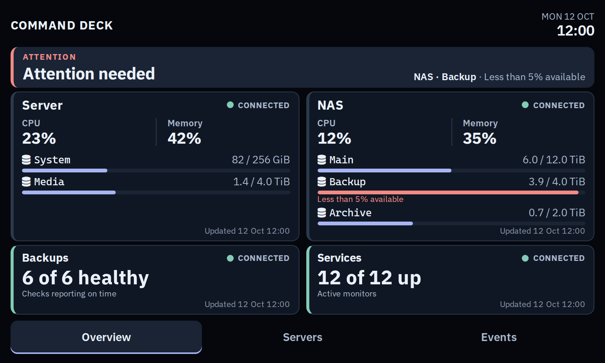
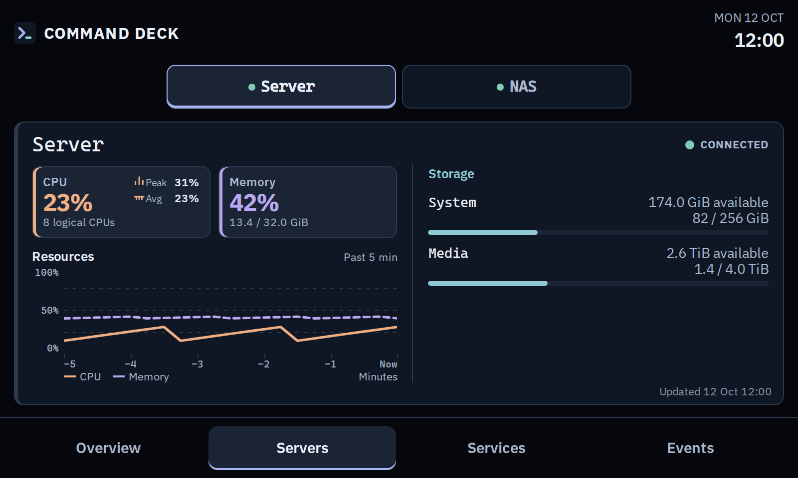
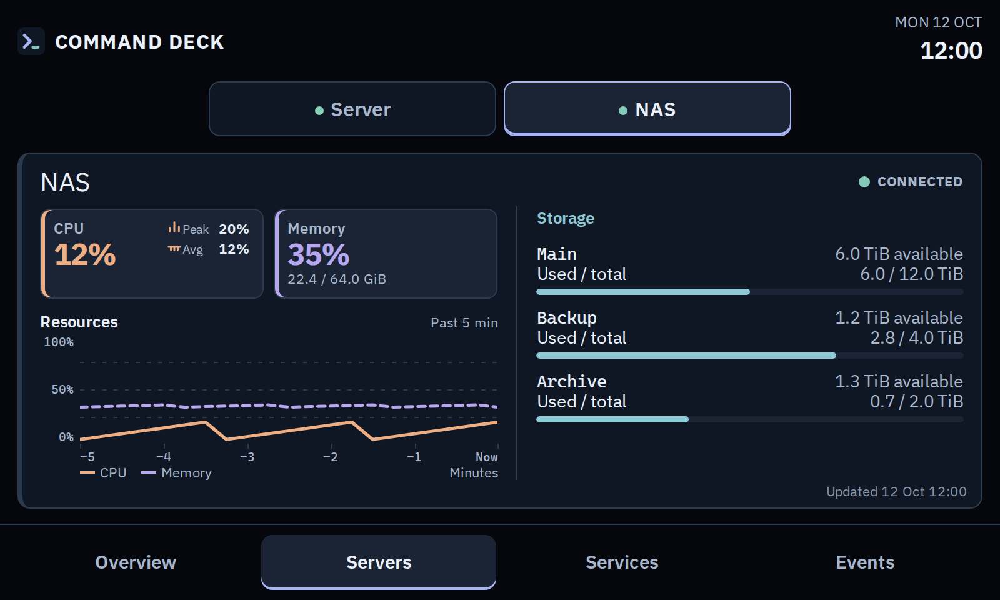
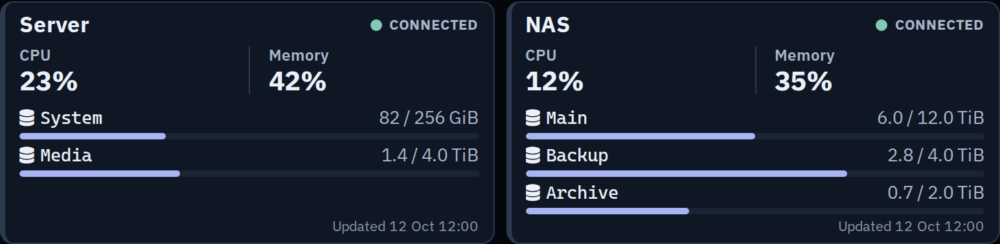

# Command Deck

A small dashboard for homelab health. It reads Prometheus, Healthchecks, Uptime Kuma, and optional TrueNAS data without access to Docker or monitored files.

## Screenshots

| Healthy overview | Overview with an alert |
| --- | --- |
|  |  |

| Server detail | NAS detail |
| --- | --- |
|  |  |



*Screenshots use illustrative data, not live hosts.*

## What it shows

- **Overview:** up to two chosen hosts, backup status, active service monitors, and the most urgent current issue.
- **Servers:** current CPU and memory, five-minute trends, sampled CPU peak and average, and storage. Select any configured host for detail.
- **Events:** current warnings and source failures. Failure and recovery history is not connected yet.

Missing or stale data is marked unknown or disconnected; it is never shown as healthy. An open page warns when it loses its connection to Command Deck.

## Run with Docker

Copy the examples and set your source addresses in `config.yml`. Put API keys and optional URL overrides in `.env`. Both files are ignored by Git.

```sh
cp config.yaml config.yml
cp .env.example .env
# Edit config.yml and .env for your sources.
docker compose config --quiet
docker compose pull
docker compose up -d
```

Open `http://127.0.0.1:8765`. The example configuration has no live scrape targets, so telemetry stays unknown until you configure them. Compose pulls the published image, mounts `config.yml` read-only at `/app/config.yaml`, and passes `.env` as environment variables. The container runs as a non-root user and does not mount the Docker socket. The app reads the configured path as YAML regardless of whether the host file ends in `.yml` or `.yaml`.

If you already have `config.local.yaml`, keep it and set `COMMAND_DECK_CONFIG_HOST_FILE=./config.local.yaml` in `.env`. You can use any `.yml` or `.yaml` host filename this way; do not edit the tracked `config.yaml` example with private host details. The app's `COMMAND_DECK_CONFIG_FILE` remains `/app/config.yaml` inside the image.

## Configure sources

| Source | What to set |
| --- | --- |
| Prometheus | Set its URL, each host's `instance` label, and any filesystems in `config.yml` (copied from [`config.yaml`](config.yaml)). Node exporter supplies CPU, memory, and filesystem values. Set `show_on_overview: true` on at most two hosts. |
| Healthchecks | Tag backup checks with `healthchecks.backup_tag` and set a project-scoped, read-only Management API key in `.env`. |
| Uptime Kuma | Set `COMMAND_DECK_UPTIME_KUMA_URL` in `.env`; add an API key only if `/metrics` requires one. Its count covers active monitors, not paused monitors. |
| TrueNAS | For SCALE 25.04+, set the host's `source` to `truenas_graphite` and configure its `instance` and `graphite_prefix` for CPU and memory. For storage, set the TrueNAS HTTPS origin, username, and API key in `.env`, and `truenas.host_id` in `config.yml`. Use a dedicated account with `POOL_READ` and `DATASET_READ` and a trusted certificate. |

TrueNAS storage shows each root dataset's **available** space. Its displayed total is used plus available, not the raw capacity of the pool's disks. If the API connection is missing, storage stays unknown. Older TrueNAS releases use a different API and are not supported. See [`config.yaml`](config.yaml) and [`.env.example`](.env.example) for all settings. Keep credentials out of YAML and URLs.

The app reads [Healthchecks Management API v3](https://healthchecks.io/docs/api/) and [Uptime Kuma Prometheus metrics](https://github.com/louislam/uptime-kuma/wiki/Prometheus-Integration). The Servers graph fetches five minutes of Prometheus history when a host is selected.

## Develop locally

Requires Python 3.12+, [uv](https://docs.astral.sh/uv/), Node.js, and npm. Copy and configure the example files as above, then run:

```sh
uv sync --group dev
npm install
npm run build:assets
COMMAND_DECK_CONFIG_FILE=config.yml uv run --env-file .env uvicorn command_deck.main:app --reload
```

Open `http://127.0.0.1:8000`. Check changes with `uv run pytest -q` and `uv run ruff check .`.

## Continuous integration and container images

Pull requests into `develop` or `main` validate the version files, compile assets, run Python lint and tests, and build the container. The same checks run after a push to `develop`. Every push to `main` publishes amd64 and arm64 images as `ghcr.io/mravalanche/command-deck:latest` and `:sha-COMMIT_SHA` (the full SHA). The first successful `main` build for each new version also publishes `:vX.Y.Z` and creates the matching Git tag and GitHub Release at that commit. Publishing uses the workflow's `GITHUB_TOKEN`; no registry credential needs to be configured.

To prepare the next release, update the Python and asset package versions together on a feature branch, then merge through a PR into `develop` and a release PR into `main`:

```sh
uv version 0.1.1 --no-sync
npm version 0.1.1 --no-git-tag-version
```

These commands update `pyproject.toml`, `uv.lock`, `package.json`, and `package-lock.json`. CI checks that all four agree. Use the version you intend to release in place of `0.1.1`. For a fixed deployment, set `COMMAND_DECK_IMAGE_TAG=vX.Y.Z` in `.env`; the Compose default follows `latest`.

The published Command Deck package allows anonymous pulls. If you fork the repository, GitHub may create your package as private; set its visibility to public after the first publish if you want anonymous pulls.

## Deploy on your network

Docker binds to loopback by default. To view the dashboard from another device, set `COMMAND_DECK_BIND_ADDRESS` in `.env` to the host's private address and run `docker compose up -d` again to apply the new port binding. There is no built-in login; restrict access with your network or proxy. `/healthz` checks process liveness only.

## License

Command Deck is licensed under the [GNU AGPLv3](LICENSE). Bundled fonts and htmx retain the licenses included alongside them in `src/command_deck/static`.
