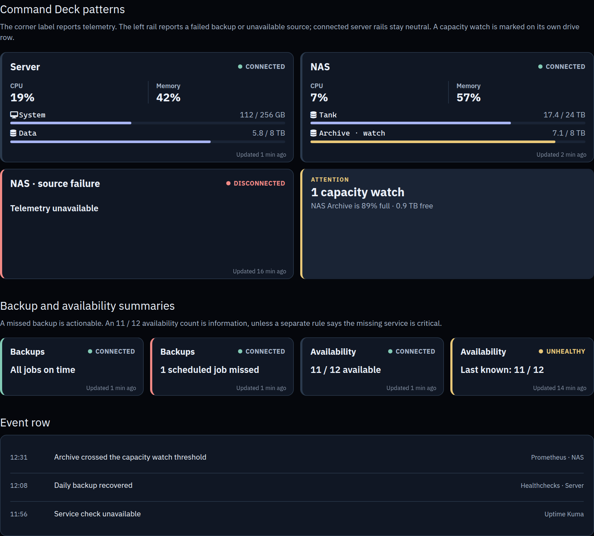
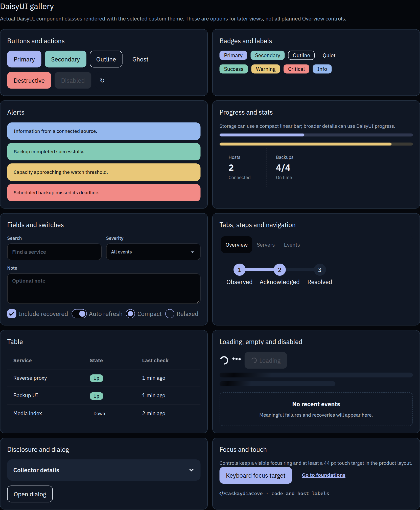

# Components and dashboard patterns

[Design overview](../DESIGN.md) · [Interactive showcase](component-showcase.html) · [Theme reference](THEME.md)

The Overview is glanceable, with more detail in Servers, Services, and Events. The target display sizes are 800 × 480 and 1024 × 600; confirm the physical panel later. The showcase contains illustrative values only.

## Product patterns

- **Telemetry label:** a subtle dot and word: CONNECTED, UNHEALTHY, DISCONNECTED, or NOT CONFIGURED. This reports data freshness, source quality, or incomplete setup, not the monitored system's health.
- **Server card:** a neutral left rail while telemetry is connected. A capacity concern appears on its storage row and in Attention. A disconnected server has a red rail and “Telemetry unavailable” instead of stale values.
- **Backup card:** a green rail when scheduled jobs are on time; red when a job is missed or failed. The telemetry label separately reports whether Healthchecks data is trustworthy.
- **Availability card:** a count such as 11 / 12 is neutral information. A missing service is elevated only if its importance or an existing alert warrants it. Unhealthy telemetry has an amber rail; disconnection has a red rail.
- **Freshness:** each card has a subdued relative update age in its bottom right. The date and seconds clock in the upper right use the display device's local time. Production freshness comes from actual collector timestamps.
- **Navigation and controls:** at least 44 px touch targets, visible keyboard focus, and no unnecessary animation. CPU and memory use split numbers with a quiet divider.
- **Status model:** OK, WARNING, CRITICAL, and UNKNOWN for monitored conditions. Unknown or stale data must not appear healthy. Source health is separate.

### Servers view

- Show one selected host's detail at a time. The host selector follows config file order.
- With a few hosts, use equal-width host buttons and no arrows. With many hosts, use a horizontally scrollable strip, aligned arrow controls, and visible selection. Keep host buttons at least 44 px high.
- The selected host shows split CPU/memory numbers and compact storage bars. Prometheus hosts also show a five-minute CPU and memory trend with a legend. Proxmox hosts show current physical node metrics and root filesystem capacity, with an explicit message that history is unavailable. See the [Proxmox setup guide](../docs/proxmox.md) for its scope. The [Servers preview](servers-preview.html) has three-host and eight-host examples; all values are illustrative.
- Fetch a selected Prometheus host's trend from `query_range` when selected. Cache the response briefly; do not store a second time series in the app. If history is incomplete, label the available window honestly.

## DaisyUI options

| Pattern | App use |
| --- | --- |
| Attention strip, server card, split CPU/memory values, compact storage row, telemetry dot and word, relative update age | Canonical Overview and Servers patterns. |
| Backup and availability summary cards | Canonical Overview patterns. Show UNKNOWN until their collectors are connected; never use the showcase's sample values as live data. |
| Current signal row with severity, reason, source, and data age | Canonical Events pattern until a verified event feed can supply failure and recovery times. |
| DaisyUI buttons, inputs, selects, loading indicator, and skeleton | Shared controls and HTMX loading states. Use the same focus and touch sizing throughout. |
| DaisyUI table and disclosure | Detail views where extra rows and explanations are useful. Keep Overview compact. |
| DaisyUI alert | Inline errors or confirmations in detail views. The custom Attention strip remains the dashboard's problem summary. |
| DaisyUI badges, stats, steps, and static tab example | Gallery reference only. Health and telemetry keep their established labels and rail treatment. |

The showcase dialog demonstrates styling. The four application views—Overview, Servers, Services, and Events—use the established navigation instead of DaisyUI tabs. The [interactive showcase](component-showcase.html) contains the full foundations, product patterns, and DaisyUI gallery.
