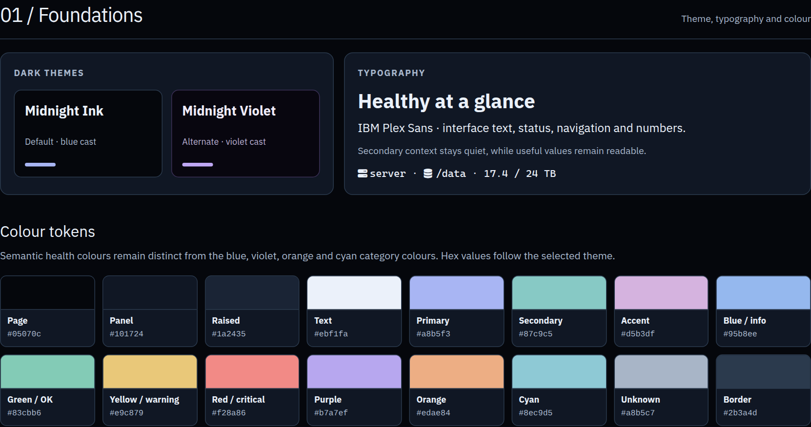
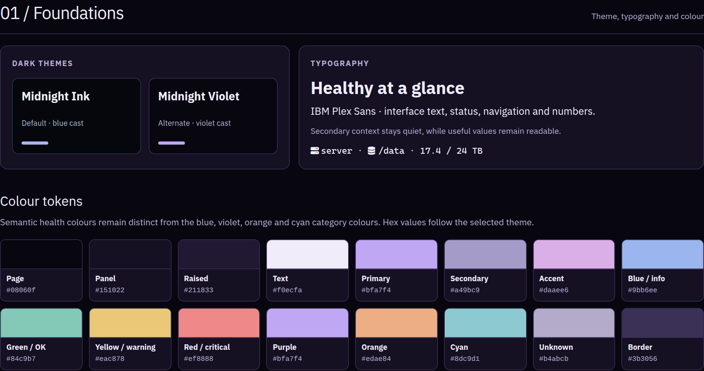

# Theme and typography

[Design overview](../DESIGN.md) · [Interactive showcase](component-showcase.html) · [Theme source](themes.css)

Command Deck currently uses **Midnight Ink** without a theme switcher. **Midnight Violet** is an alternate in the standalone design showcase. Both themes use the same semantic meanings. Colour is paired with text; it is never the only health cue.

## Midnight Ink

## Midnight Violet

## Colour tokens

| Token | Midnight Ink | Midnight Violet | Use |
| --- | --- | --- | --- |
| Page / base-100 | #05070C | #08060F | Main background |
| Panel / base-200 | #101724 | #151022 | Cards |
| Raised / base-300 | #1A2435 | #211833 | Attention, selection |
| Text / base-content | #EBF1FA | #F0ECFA | Main text |
| Muted | #A8B7CC | #B8AED2 | Secondary text |
| Border | #2B3A4D | #3B3056 | Quiet separation |
| Primary | #A8B5F3 | #BFA7F4 | Navigation and focus |
| Secondary | #87C9C5 | #A49BC9 | Secondary actions |
| Accent | #D5B3DF | #DAAEE6 | Rare highlights |
| Neutral | #243146 | #302742 | Neutral controls |
| Blue / info | #95B8EE | #9BB6EE | Information |
| Green / success | #83CBB6 | #84C9B7 | Healthy, connected |
| Yellow / warning | #E9C879 | #EAC878 | Actionable watch |
| Red / error | #F28A86 | #EF8888 | Critical, disconnected |
| Unknown | #A8B5C7 | #B4ABCB | Missing or unverified |
| Purple | #B7A7EF | #BFA7F4 | Category colour |
| Orange | #EDAE84 | #EDAE84 | Category colour |
| Cyan | #8EC9D5 | #8DC9D1 | Category colour |

The canonical DaisyUI 5 theme definitions and shape tokens are in [themes.css](themes.css). The standalone showcase loads DaisyUI and IBM Plex Sans online, plus a browser-ready theme stylesheet generated by [build-showcase-theme.py](build-showcase-theme.py). The application bundles compiled CSS, HTMX, and fonts locally.

## Typography

- **IBM Plex Sans:** body, controls, navigation, status, and large values. Use 400 for prose, 600 for labels, and 700 for major headings and values.
- **CaskaydiaCove Nerd Font:** hostnames, paths, units, and short technical labels. Do not rely on a font glyph alone for critical status.
- Start with 16 px body labels, 19–21 px values, 26–28 px top status, and 13–14 px secondary context. Card update ages can be 11–12 px because they are supplementary.
- Use tabular numerals for changing values and capacity pairs. Application fonts and licenses are bundled locally.
